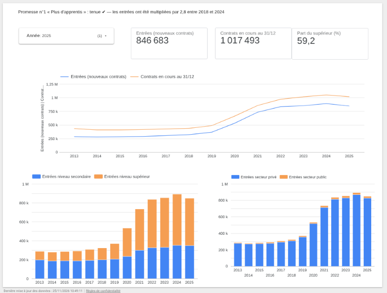
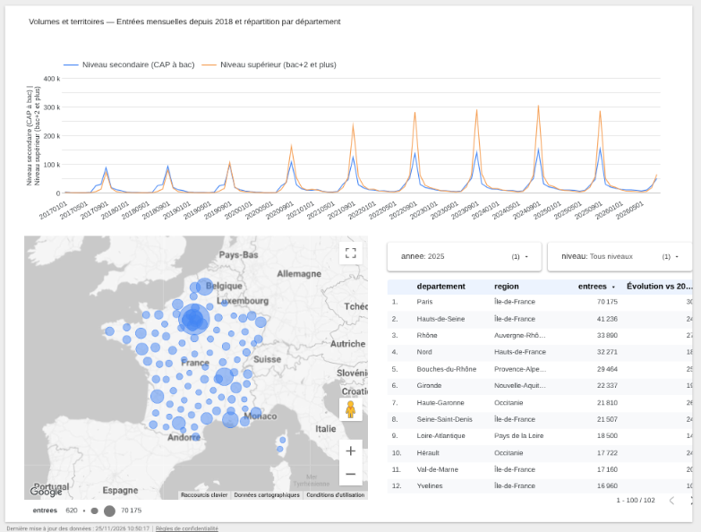
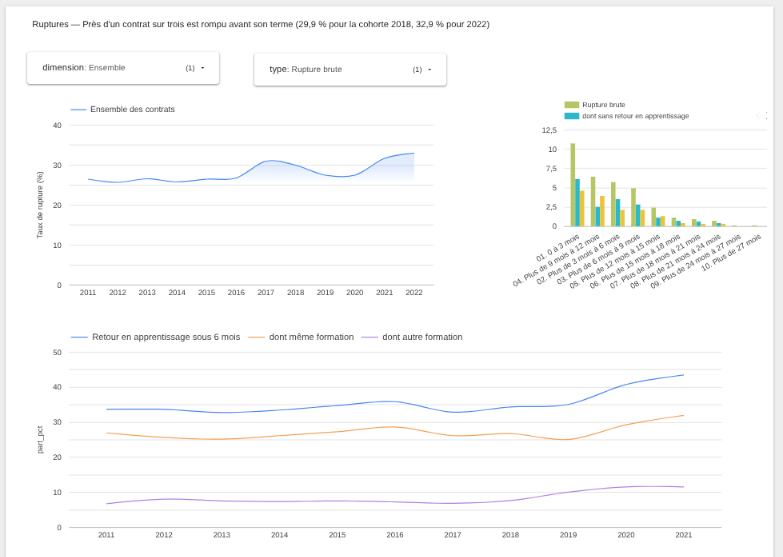
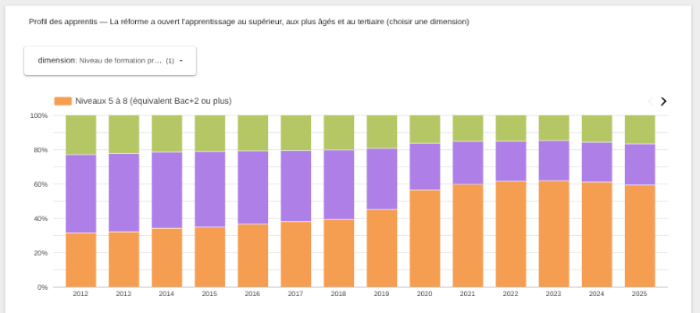
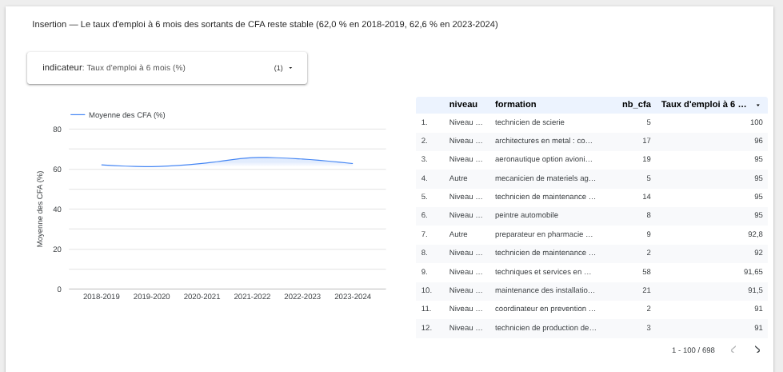
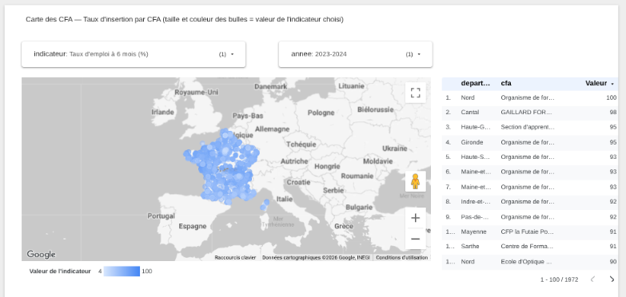
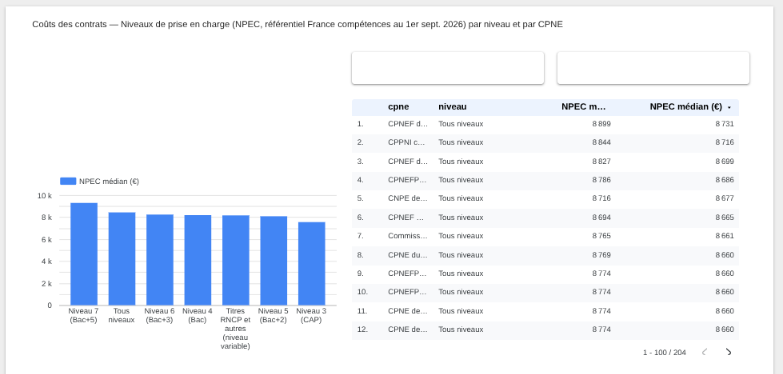

# L'apprentissage en France depuis la réforme de 2018

Un tableau de bord **Looker Studio** qui pose une question simple : la réforme de l'apprentissage de 2018 (loi « Avenir professionnel ») a-t-elle tenu ses promesses ?

**Ouvrir le tableau de bord : https://lookerstudio.google.com/reporting/218906b0-6d4d-4896-9c15-d30ade2ba43b**

Sept pages, chacune avec un constat en titre, des filtres (année, niveau, dimension, indicateur) et des données publiques uniquement.

## Ce que montrent les données

| Thème | Constat |
|---|---|
| **Volumes** | Les entrées en apprentissage ont été multipliées par 2,8 entre 2018 et 2024. En 2025 : 846 683 nouveaux contrats et 1 017 493 contrats en cours au 31 décembre. |
| **Profil** | La réforme a ouvert l'apprentissage au supérieur : 59,2 % des entrées de 2025 visent un niveau bac+2 ou plus. |
| **Ruptures** | Près d'un contrat sur trois est rompu avant son terme : 29,9 % pour la cohorte 2018, 32,9 % pour la cohorte 2022. |
| **Insertion** | Le taux d'emploi à 6 mois des sortants de CFA reste stable : 62,0 % en 2018-2019, 62,6 % en 2023-2024. |
| **Coûts** | Les niveaux de prise en charge (NPEC) varient selon le diplôme et la branche (CPNE), d'après le référentiel de France compétences au 1er septembre 2026. |

## Les pages

### 1. Vue d'ensemble
Entrées et contrats en cours depuis 2013, répartition entre secondaire et supérieur, et entre secteur privé et public.

### 2. Volumes et territoires
Entrées mensuelles par niveau, carte et classement des départements avec l'évolution par rapport à 2018.

### 3. Ruptures
Taux de rupture par année d'entrée, moment de la rupture dans le contrat, et retour en apprentissage dans les 6 mois.

### 4. Profil des apprentis
Répartition des entrées selon la dimension choisie : niveau de formation, âge, secteur.

### 5. Insertion
Taux d'emploi à 6 mois des sortants de CFA, et classement des formations.

### 6. Carte des CFA
Indicateurs d'insertion par CFA, sur une carte : la taille et la couleur des bulles suivent l'indicateur choisi.

### 7. Coûts (NPEC)
Niveau de prise en charge médian des contrats, par niveau de diplôme et par CPNE.

## Sources

| Source | Producteur | Utilisation |
|---|---|---|
| Séries longues sur les contrats d'apprentissage (caractéristiques, ruptures, travailleurs handicapés) | DARES | Volumes, profil des apprentis, ruptures |
| Séries mensuelles des entrées et des contrats en cours (apprentissage et contrats de professionnalisation), par département | DARES | Volumes et territoires |
| InserJeunes : indicateurs par CFA et par formation | Ministère de l'Éducation nationale (DEPP) | Insertion, carte des CFA |
| Liste des établissements de formation | Export du 13/11/2026 | Localisation des CFA |
| Référentiel unique des NPEC au 1er septembre 2026 | France compétences | Coûts des contrats |

Les données sont publiques et sous Licence Ouverte.

## Méthode

1. **Préparation** : les fichiers sources (Excel et CSV) ont été remis au format long, une ligne par observation, sans cellule vide. Looker Studio traite sinon une colonne numérique contenant des vides comme du texte.
2. **Localisation des CFA** : les fichiers ne donnent pas de coordonnées GPS. Chaque CFA est placé au centre de sa commune : la carte est juste à l'échelle d'un département, pas d'une rue.
3. **Indicateurs calculés** : l'évolution par rapport à 2018 est un champ calculé dans Looker Studio.
4. **Récit** : chaque page s'ouvre sur un constat chiffré qui répond à une des promesses de la réforme.

## Limites

- **Insertion** : InserJeunes ne couvre que les formations du CAP au BTS, et ses indicateurs par CFA cumulent deux promotions. On ne sait donc rien de l'insertion des apprentis du supérieur, qui sont pourtant la majorité depuis 2020.
- **Coûts** : un seul référentiel NPEC est utilisé (septembre 2026). Sans les versions précédentes, on ne peut pas suivre l'évolution des coûts depuis 2018.
- **Carte** : les positions des CFA sont approximatives (centre de la commune).

## Outils

Looker Studio · Python (pandas) pour la préparation des données · Google Drive pour le stockage des sources.
